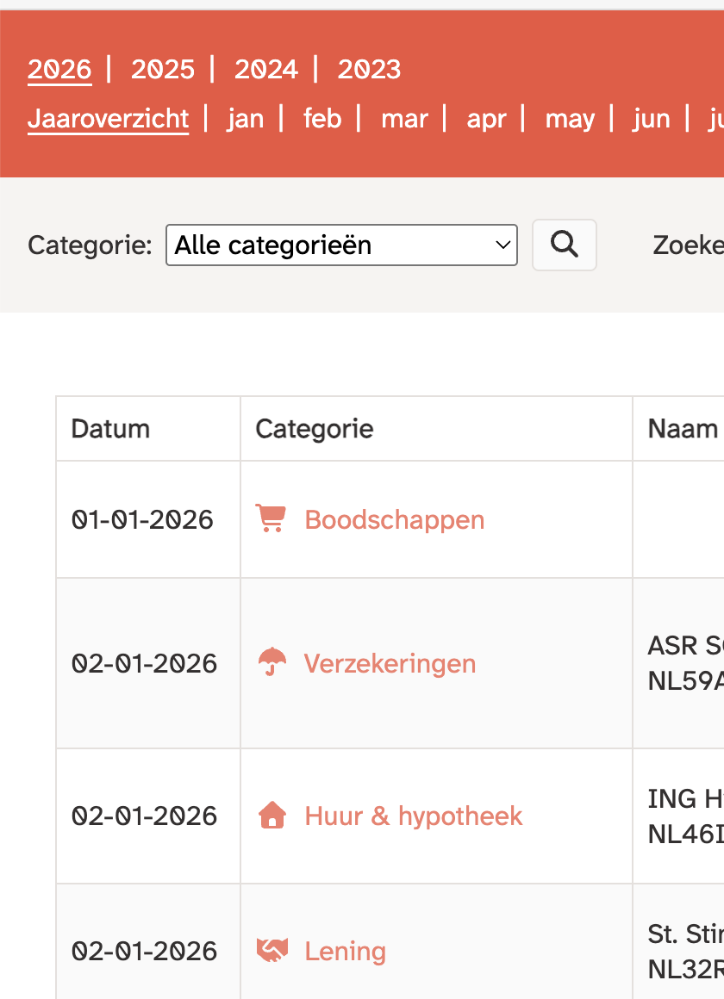
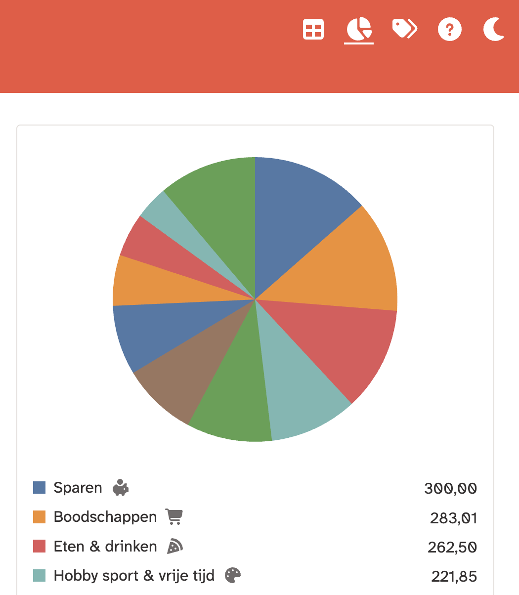

# Persoonlijke financiële administratie

Een kleine, zelfgebouwde PHP-applicatie om financiële transacties lokaal te bekijken en te beheren. Het doel is om zelf grip te houden op transacties, categorieën en de eigen financiële administratie, zonder afhankelijk te zijn van een externe budgetteringsdienst.

## Functionaliteit

- Financiële transacties importeren op basis van CSV-exports van ASN Bank.
- Transacties per jaar en maand inzien en op datum oplopend of aflopend sorteren.
- Transacties filteren op categorie en doorzoeken op naam, omschrijving, transactienummer en tags.
- Totalen per categorie bekijken in een tabel en als piechart.
- Maandelijkse trends in inkomsten en uitgaven bekijken, met filters op categorie en zoekterm. De maandtotalen tonen ook het netto saldo en linken door naar de bijbehorende transacties.
- Tags per periode bekijken, gerangschikt op gebruik, en doorklikken naar de bijbehorende transacties.
- Dark mode (woohoo!)

<p align="center">
  
  
</p>

## Technologie

- PHP
- HTML, CSS en een enkel JavaScript
- CSV-bestanden voor gegevensopslag
- Lokale ontwikkelomgeving (bijvoorbeeld MAMP)

## Gegevens importeren

De applicatie werkt met CSV-exports van ASN Bank. De transacties worden per kalenderjaar in een afzonderlijk CSV-bestand bewaard in de map `csv/`.

Voorbeeld van de mappenstructuur:

```text
csv/
├── 2024.csv
├── 2025.csv
└── 2026.csv
```

### Werkwijze

1. Categorisering wordt beheerd in de ASN omgeving.
2. Exporteer je transacties bij ASN Bank als CSV-bestand.
3. Plaats het bestand in de map `csv/`.
4. Gebruik één CSV-bestand per kalenderjaar.
5. Plaats spatie-gescheiden tags in het Notitie-veld voor verder overzicht.
6. Loop na importeren de transacties van bijvoorbeeld Tikkie, Paypal en Betaalverzoek na, die zijn vaak verkeerd gecategoriseerd. Dit kun je oplossen door Tags toe te voegen. Eventueel kun je de Categorie ook handmatig corrigeren in de ASN Bank interface en een nieuwe export maken voor Balans.

De exacte bestandsnamen en CSV-indeling moeten overeenkomen met de manier waarop de applicatie de bestanden verwerkt.

**Let op:** CSV-bestanden bevatten financiële gegevens. Neem ze niet op in een GitHub-repository en deel ze niet zonder passende beveiliging.